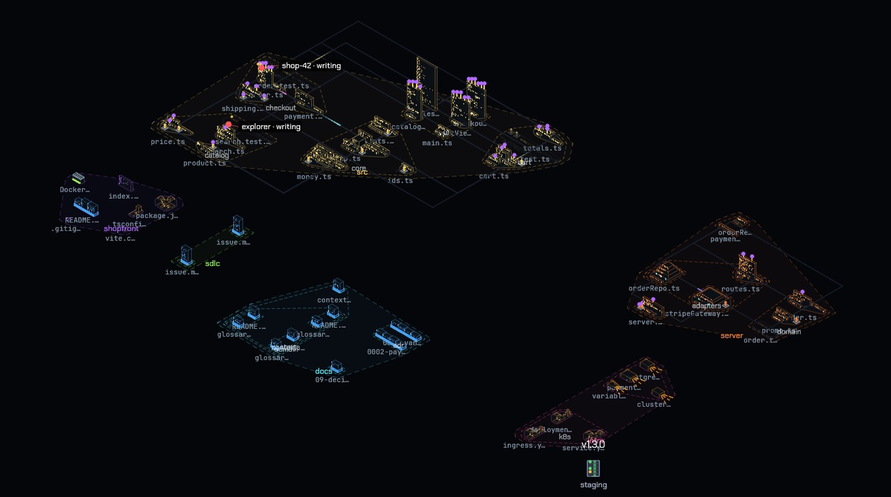
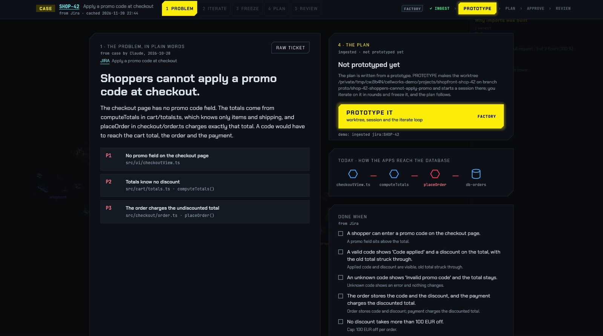
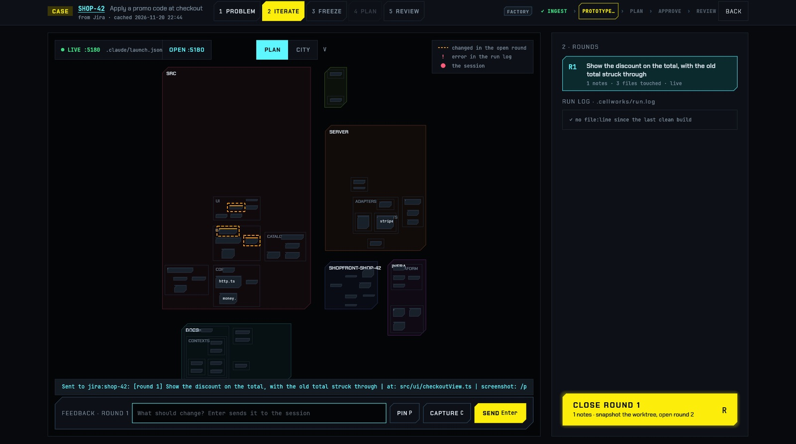
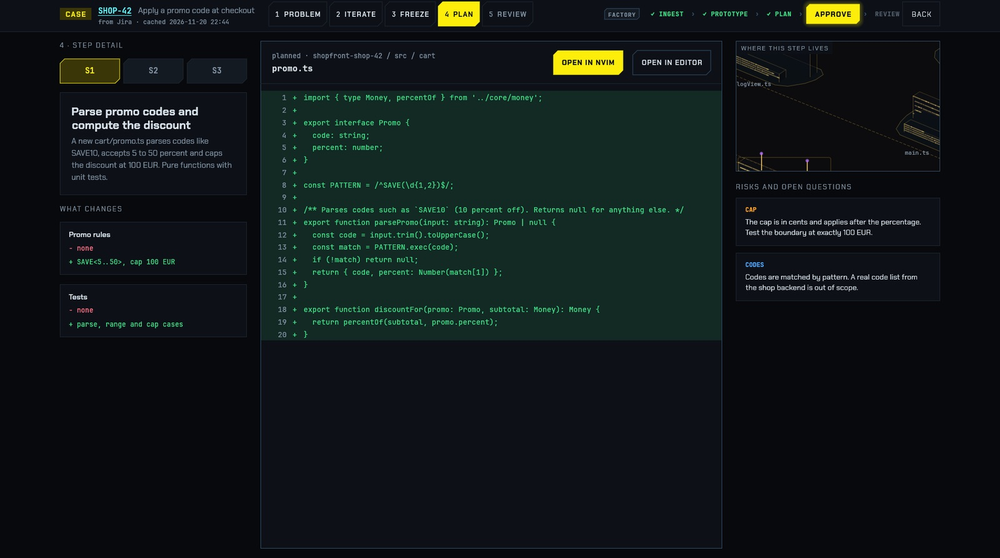
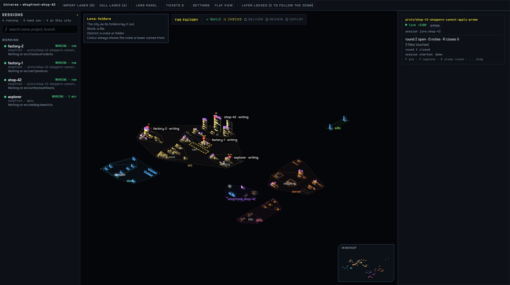
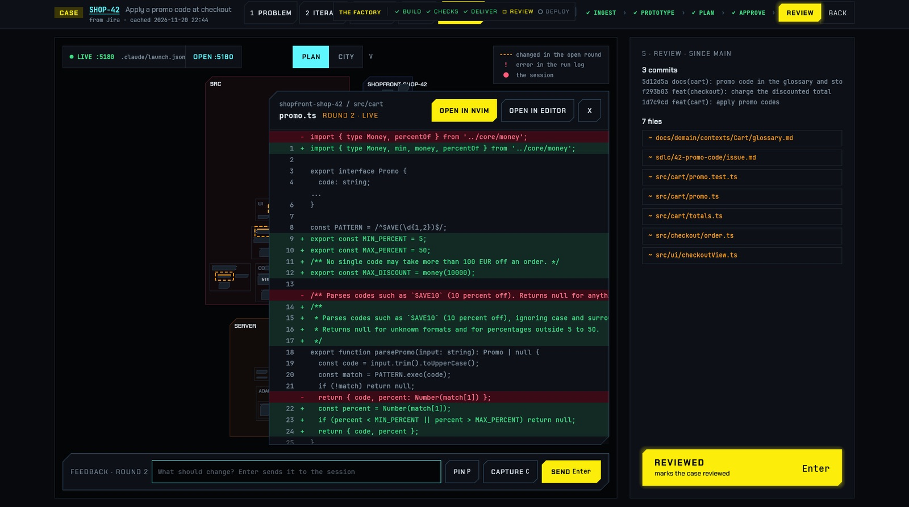
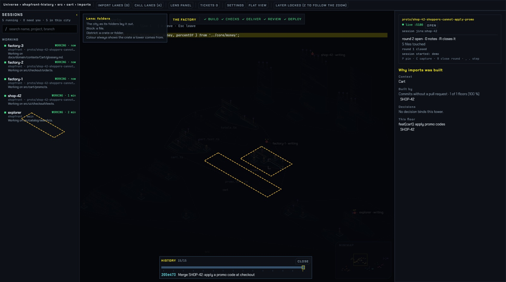
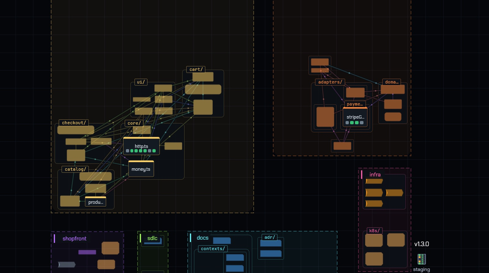
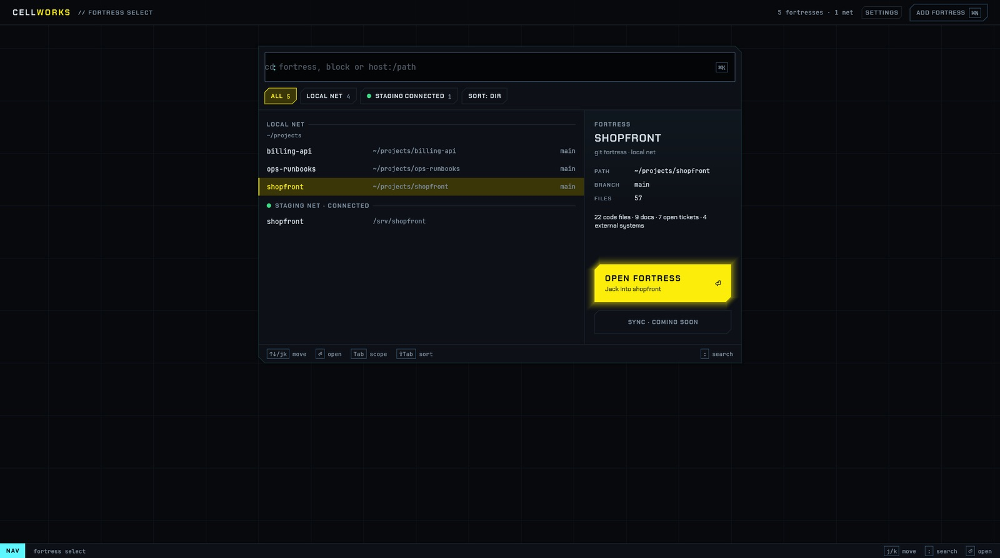

# Cellworks

**Your projects, code, agent sessions and tickets on one map.**



Cellworks is a native macOS app that draws the projects on your machine as a zoomable city. Every folder is a
district, every file a tower whose floors are its functions, and lanes show what imports or calls what. Your Claude
Code sessions walk the map to the files they are working on, and tickets from Jira, Cockpit, GitHub and Linear open as
cases you take from a problem to a running prototype, a frozen plan and a review. It runs no server and needs no
account: it reads your disk and the tools you already use (git, `claude`, `gh`, `kubectl`), and draws what it finds.

[Website](https://xunrise.github.io/cellworks/) · [Install](#install) · [First steps](#first-steps) ·
[Releases](https://github.com/Xunrise/cellworks/releases)

## From ticket to done

One ticket, SHOP-42 "Apply a promo code at checkout", from the demo shop. The
[website](https://xunrise.github.io/cellworks/#loop) walks through every step.

| 1 · Ingest | 2 · Prototype and iterate | 3 · Plan and approve |
|---|---|---|
|  |  |  |
| The case is written from the ticket and the code. | A worktree, a Claude session and the app running; you steer in rounds. | Freeze distils the session; the pipeline plans, you approve. |

| 4 · The Factory builds | 5 · Review | 6 · Deploy and trace |
|---|---|---|
|  |  |  |
| Agents commit in turn; every commit shows on the map. | Each changed file, against main. | Merged, on staging, and every line traces back to the ticket. |

## What you get

- **Code as a city.** Districts for folders, towers for files, floors for functions. Tests live in the cellar, files
  that are not code stand as buildings of their kind, and colour shows the crate or package a tower comes from.
- **Lenses.** Re-arrange the same city by folders, imports, calls, co-change (files that change together), cells (your
  bounded contexts), or your own custom layout. The lens panel asks Claude a question about the project and builds a
  lens that answers it.
- **Lanes.** Import lanes (G) and call lanes (A) between towers, with traffic flowing downstream. Select a tower to
  follow its lanes.
- **A 2D factory view.** V flips the open project between the 3D city and a flat floor plan seen from above; each
  project remembers its choice.
- **Live agent sessions.** Claude Code sessions show up as units on the towers they read and write, with a sessions
  pane to follow and steer them.
- **Why was this built?** Select a tower or a floor and the why panel shows its history line by line: the commits,
  pull requests and stories behind it.
- **Tickets and cases.** T opens one ticket panel for Jira, Cockpit, GitHub and Linear. A ticket opens as a case:
  ingest it into problems tied to code, prototype it in a worktree with the app running, iterate in rounds, freeze,
  plan and review.
- **Pull request review mode.** P lists pull requests; one opens as its own city at the head, with a before/after
  against the merge base.
- **Keyboard first.** A launcher palette for every project on your disk and on reachable hosts, vim keys in the
  Explorer, and an embedded Neovim for files.
- **Updates itself.** The app checks GitHub Releases and swaps itself in place, with a rollback if the new version does
  not start.

| The 2D flat view (V) with belts | The launcher |
|---|---|
|  |  |

## Supported languages

Cellworks reads code with [tree-sitter](https://tree-sitter.github.io/). Two languages are analysed in depth today:

| Language | Extensions | Functions and types as floors | Import lanes | Call lanes | Tests in the cellar |
|---|---|---|---|---|---|
| Rust | `.rs` | yes | yes | yes | `#[test]`, `#[cfg(test)]` modules |
| TypeScript and JavaScript | `.ts` `.tsx` `.mts` `.cts` `.js` `.jsx` `.mjs` `.cjs` | yes | yes | yes (by name) | `describe` / `it` / `test`, `*.test.*`, `*.spec.*` |

Every other file still stands on the map. Files in other languages (Python, Go, Java, Kotlin, …) become plain code
towers: they are sized by their lines and carry git history and the why panel, but have no functions inside and no
lanes. Non-code files stand as buildings of their kind:

| Building | Files |
|---|---|
| Library | Docs: `.md`, `.markdown`, `.rst` |
| Switchboard | Configuration: `.yaml`, `.yml`, `.json`, `.toml` |
| Courthouse | Specifications: Gherkin `.feature` |
| Plant | Infrastructure: `.tf`, `.tfvars` |
| Customs house | Contracts: `.proto` |
| Slab | Schemas: `.sql` |
| Depot | Build: `Dockerfile*`, `Makefile`, `justfile`, shell scripts |
| Vault | Secrets: `.env*` (examples as a glass vault) |
| Ghost | Generated: lockfiles and snapshots |

Images and everything else stand as plain towers.

### Add your own language

A language is one module in `crates/code-analysis` that turns source files into map items. Python as the example:

1. **Add the grammar.** Add its tree-sitter crate to `crates/code-analysis/Cargo.toml`, in a version built for
   `tree-sitter` 0.25 (e.g. `tree-sitter-python`).
2. **Write the reader.** Create `crates/code-analysis/src/python.rs` with one entry point, the same shape as
   `rust/mod.rs` and `typescript.rs`:

   ```rust
   pub(crate) fn read(root: &Path, files: &[PathBuf]) -> BTreeMap<PathBuf, Vec<Item>>
   ```

   - **Which files:** pick yours by extension, skip very large ones, and parse each with the grammar.
   - **Items:** emit one `cellworks_map::Item` per function, class, method or type, with:
     - `name` and `path` (the file plus the item's name);
     - `kind`, plus `tests: true` for tests;
     - one `Floor` per source line (number, text, indent, width and tokens);
     - a `Declaration` saying what it declares and whether it is public.
   - **Parse failures:** leave out any file you cannot parse. A file no reader returns falls back to a plain tower
     (`plain.rs`).
3. **Register it.** In `crates/code-analysis/src/lib.rs`, add `mod python;` and
   `items.extend(python::read(root, &files));` next to the Rust and TypeScript readers.
4. **Lanes (optional, recommended).** Resolve each import statement to the file and item it names, and fill
   `Floor::imports` on that line. Fill `Floor::calls` with the items a line calls. `typescript.rs` (`imports_of`,
   `resolve`, `link`) is the smallest worked example. Lanes and the imports and calls lenses then work without further
   changes.
5. **Test it.** Unit-test the reader on small inline sources, as the `tests` module at the end of `typescript.rs`
   does, and run the checks in [CONTRIBUTING.md](CONTRIBUTING.md).

Pull requests adding languages are welcome.

## Install

Cellworks runs on **macOS 13 or later on Apple silicon**. It needs `git`; `claude`, `gh`, `nvim`, `kubectl` and
`cockpit` light up more of the map when they are on your PATH.

**One line**

```sh
curl -fsSL https://raw.githubusercontent.com/Xunrise/cellworks/main/install.sh | sh
```

It reads the latest release's `manifest.json`, downloads the app, checks its size and SHA-256, and installs
`Cellworks.app` to `/Applications` (or `~/Applications` when `/Applications` is not writable; `CELLWORKS_INSTALL_DIR`
to choose). No sudo. An existing Cellworks.app is replaced, and put back if anything fails. `| sh -s -- --version 0.3.0`
pins a version.

**Homebrew**

```sh
brew install --cask xunrise/tap/cellworks
```

**Manual download**

Download `cellworks-app-<version>.zip` from the [releases page](https://github.com/Xunrise/cellworks/releases/latest)
and drag `Cellworks.app` to Applications. The app is ad-hoc signed, not notarized, so macOS blocks the first launch of
a browser download: right-click Cellworks.app, choose **Open**, and confirm once. (The installer and Homebrew paths do
not hit this, or tell you how to clear it.)

**From source**

```sh
cargo install --git https://github.com/Xunrise/cellworks --locked
```

Needs Rust 1.85 or later. This installs the bare `cellworks` binary; the self-updater only works in the `.app`, so
update a source install by running the command again. `scripts/package-app.sh` builds the `.app` yourself.

## First steps

1. **Open a project.** Cellworks starts with the launcher: every git repository under `~/Projects` (change it in
   Settings), grouped by where it lives. Type to filter, Enter or a double-click opens one as a city.
2. **Move around.** Scroll or pinch to zoom, drag or use the arrows to pan, F to fit. Enter steps one layer in, Esc one
   out. Enter on a tower steps inside it, where j/k move between floors.
3. **Change the question.** L cycles the lens, G and A toggle import and call lanes, V switches to the flat view.
4. **Bring in the work.** T opens the ticket panel; click a ticket to open it as a case.

| Key | Does |
|---|---|
| V | Switch the open project between the 3D city and the 2D flat view |
| T | Open or close the ticket panel |
| E (or Cmd+B) | Open or close the Explorer: j/k move, l/h unfold and fold, `/` filters, Shift+L next lens |
| L | Next lens |
| G / A | Import lanes / call lanes |
| F, Q | Fit the city into view, turn it a quarter (Shift+Q back) |
| Enter / Esc | One layer in / one layer out |
| Z | Lock the layer against the zoom, or let it follow again |
| I | Show or hide ignored files |
| S | Sessions pane |
| P | Pull requests to review |
| Cmd+K | In the launcher: jump to the search field and back |
| Cmd+, | Settings |

## Configuration

Settings (Cmd+,) edits `~/Library/Application Support/Cellworks/settings.toml`: project folders, ticket sources, map
defaults (view, lens, lanes, ignored files), the editor command, the cases and skills folders, and hourly update checks.
Changes save as you make them; the first write keeps your original as `settings.toml.bak`, since TOML comments do not
survive. Keys the window does not own, such as `added_folders`, `[projects."<path>"]` (for example the cells of a
project) and `[hosts."<name>"]` (remote projects over ssh), are kept as they are.

Environment variables override the file, and the settings window shows which field one has taken over:

| Variable | Overrides |
|---|---|
| `CELLWORKS_JIRA_SITE` | `tickets.jira.site`, the Jira site to use when your sign-in reaches several |
| `CELLWORKS_JIRA_OFFLINE` | `tickets.jira.offline`: read the cached tickets, never the network |
| `CELLWORKS_COCKPIT_URL` | `tickets.cockpit.url` (default `http://127.0.0.1:4747`) |
| `CELLWORKS_GITHUB_REPOS` | `tickets.github.repos`, extra `owner/repo` lists to read issues from |
| `CELLWORKS_LINEAR_API_KEY` | the Linear key from the Keychain |
| `CELLWORKS_CASES` | `cases.folder` (default `~/.cellworks/cases`) |
| `CELLWORKS_SKILLS` | `skills.folder` |

### Ticket sources

Each source is switched on in Settings → Tickets, where **Test** checks the connection.

- **Jira.** Click **Jira sign in**: your browser opens Atlassian's sign-in, and Cellworks syncs through Atlassian's
  remote MCP server as its own OAuth client. Set the site if your account reaches more than one.
- **Cockpit.** Cellworks talks to Cockpit's local HTTP server on `127.0.0.1:4747`, or runs the `cockpit` binary when
  the server is down.
- **GitHub.** Uses `gh`: run `gh auth login` once. Issues assigned to you are listed, plus those of any repositories
  you add.
- **Linear.** Paste a Linear personal API key and click **Store key**: it goes to the macOS
  Keychain, never into `settings.toml`.

Ticket status changes made in Cellworks go back to Cockpit, GitHub and Linear; Jira is read-only.

## Updates

Running from `Cellworks.app`, Cellworks reads
[`manifest.json`](https://github.com/Xunrise/cellworks/releases/latest/download/manifest.json) of the latest release at
start and every hour (switch it off in Settings → Updates). When a newer version exists a badge in the corner offers it.
The download is checked against the manifest's size and SHA-256 and its code signature, then **Restart** swaps the new
app in. If the new version does not report a good start within two minutes, the old one is put back.

## Build from source

```sh
cargo run                       # opens the window
cargo build --release           # target/release/cellworks
scripts/package-app.sh          # dist/Cellworks.app, its zip and manifest.json
cargo test --workspace          # unit and acceptance tests; no test opens a window
```

[CONTRIBUTING.md](CONTRIBUTING.md) has the checks a change must pass, the repository layout, how releases are cut and
how the screenshots above are rendered.

## Architecture

A Rust workspace on [egui](https://github.com/emilk/egui) with the wgpu backend, one crate per bounded context
(Workspace, Map, Navigation, CodeAnalysis, DomainKnowledge, Sources, AgentSessions, Editing), tree-sitter for code
analysis, and external tools run as child processes. No async runtime and no server. Start at
[docs/arc42](docs/arc42/README.md) for the architecture, [docs/adr](docs/adr/README.md) for the decisions behind it and
[docs/domain](docs/domain/README.md) for the vocabulary.

## License

[MIT](LICENSE). The bundled fonts, Chakra Petch and JetBrains Mono, are under the SIL Open Font License.
