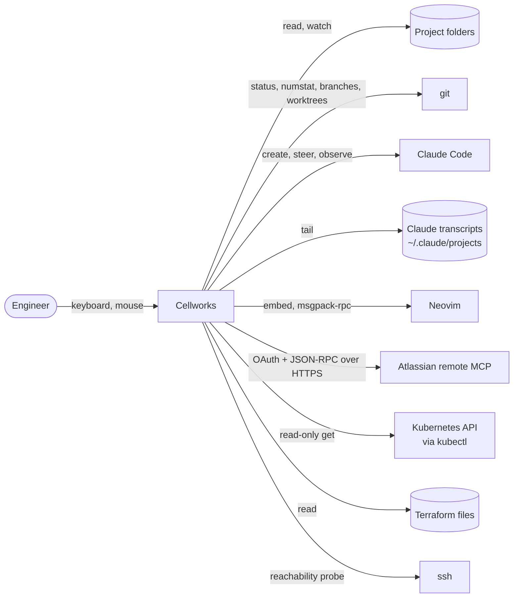

> Status: draft

# 3. Context and Scope

## 3.1 Context view

| Neighbour | What Cellworks does with it |
|---|---|
| Engineer | Navigates the map, edits files, creates and steers Claude Code sessions. |
| Project folders | Scans code, domain docs, Knex migrations, proto files and DTOs; watches for changes to rescan. |
| git | Reads the files a repository shows (`ls-files`), status, numstat, branches and worktrees; switches branches and adds worktrees on request. |
| Claude Code | Creates and steers sessions that survive restarts of Cellworks. |
| Claude transcripts | Discovers every session on the machine and follows what it reads and writes. |
| Neovim | Embedded editor. |
| Atlassian remote MCP | Syncs Jira projects. |
| Kubernetes API | Reads live workloads, read-only. |
| Terraform files | Reads infrastructure blocks per environment. |
| ssh | Probes once per launch whether each configured remote host is reachable. |

Out of scope: writing to clusters, any network server run by Cellworks.

## 3.2 Foreign systems

All foreign systems are local tools or files except Atlassian. "Contact for outages" is the product owner for local
tools; there is no SLA.

### Claude Code and transcripts

- **Protocol:** transcripts are JSON lines under `~/.claude/projects/**/*.jsonl`, tailed read-only. How Cellworks
  creates and steers sessions is open; the prototype ran the `claude` CLI in a pseudo-terminal owned by a detachable
  session host.

  > TODO: depends on the decision about how sessions are driven (to be tested; see chapter 4).
- **Data:** session input and output; transcript events (tool calls with file paths, permission prompts).
- **Auth:** the user's own Claude Code login; Cellworks never handles its credentials.
- **Quirks:** the transcript format is not a published contract and can change with Claude Code releases; parse
  tolerantly and ignore unknown events.

### git

- **Protocol:** the `git` CLI, run per project.
- **Data:** the files a repository shows and does not ignore (`ls-files`), status, numstat, branch and worktree lists.
- **Auth:** none beyond the user's git setup; Cellworks does not push or fetch.

### Neovim

- **Protocol:** `nvim --embed`, msgpack-RPC over stdio, `ext_linegrid` UI.
- **Data:** grid updates out, input and commands in.
- **Auth:** none.
- **Quirks:** requires a user-installed `nvim`; auto-save is configured by Cellworks so git sees changes.

### Atlassian remote MCP

- **Protocol:** JSON-RPC over HTTPS to Atlassian's remote MCP server.
- **Data:** Jira issues, components, epics, sub-tasks, links.
- **Auth:** Cellworks is its own OAuth client: dynamic client registration plus PKCE; tokens stored locally,
  never passed on a command line.
- **Availability / contact:** Atlassian status page; outages degrade to the cached tickets.
- **Quirks:** search results arrive in two shapes (`{issues, isLast, nextPageToken}` or `{issues: {nodes, pageInfo}}`);
  OAuth callback parameters are URL-encoded and decoded exactly once. Relaying through a headless Claude session was
  rejected (about 1M tokens per sync).

### Kubernetes (via kubectl)

- **Protocol:** `kubectl get … -o json` against the user's kubeconfigs.
- **Data:** workloads, services, ingresses, environment variables (`*_SERVICE_HOST` for wiring), health.
- **Auth:** the user's kubeconfig; read-only by constraint.
- **Availability / contact:** the cluster's operators; an unreachable cluster leaves the Terraform view intact.

### Terraform files

- **Protocol:** files read from an infrastructure repository (`otc:<folder>` projects).
- **Data:** resource blocks grouped per environment.
- **Auth:** none; no `terraform` command is run.

### ssh

- **Protocol:** the `ssh` CLI, `ssh -o BatchMode=yes -o ConnectTimeout=5 -- <host> true`, run in the background once per launch for each configured host.
- **Data:** the exit status only; nothing is read from the host.
- **Auth:** the user's own ssh config and keys; Cellworks never prompts for or handles credentials.
- **Quirks:** an unreachable or password-only host reads as offline; a missing `ssh` binary marks all hosts offline.
