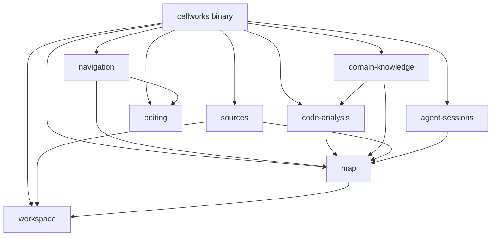

> Status: draft

# 5. Building Block View

## 5.1 Level 1: Cellworks and its neighbours

Cellworks is one native application. Its neighbours are described in [chapter 3](03-context.md): project folders,
git, Claude Code and its transcripts, Neovim, Atlassian's remote MCP, kubectl and Terraform files.

## 5.2 Level 2: crates

One crate per bounded context, plus the binary ([ADR-0002](../adr/0002-cargo-workspace-crate-per-bounded-context.md)).
Arrows point from a crate to the crate it depends on; they follow the [context map](../domain/context-map.md), where
the upstream context is the dependency.

Two relationships of the context map are not crate dependencies: CodeAnalysis → Workspace (worktrees become
projects) and AgentSessions → Workspace (session folders become projects, writes trigger rescans). As crate
dependencies they would form a cycle through `map → workspace`, so the binary wires them: it takes the events from
`code-analysis` and `agent-sessions` and calls `workspace`. Sources → Navigation ("show code") is a lane to a node in
another project and needs no crate dependency either. The binary also depends on `map` directly: it holds the opened
project's map and calls the Map's painter from the frame loop it owns, and on `editing` directly: it owns the open
editors and shows them over whichever view the map is drawn in, so they stay open across the city and the flat view. Opening a pull request as a review is wired the
same way: Sources produces the pull request, its diff, its placement on the head's towers and its story text; the
binary turns that into `cellworks_map::ReviewOverlay` (working out impacted towers itself, since Map owns the calls)
and into `cellworks_navigation::ReviewMode`, and opens the checked-out head as an ordinary project ([ADR-0011](../adr/0011-review-mode-opens-the-pull-request-head-as-the-city.md)). Neither `map` nor
`navigation` gains a dependency on `sources` for this (STORY-022).

| Crate | Context | Responsibility | Interface it offers |
|---|---|---|---|
| `workspace` | [Workspace](../domain/contexts/Workspace/Workspace.md) | Knows the projects: discovery, project identity (path, `jira:`/`otc:`/`data:` prefix or `host:path` for a remote project, case-insensitive paths on macOS), settings, rescan requests, and the custom arrangement of each project ([ADR-0006](../adr/0006-custom-arrangement-store.md)), the launcher view model, the recent store and the host probe. | Project registry, project identity, settings, rescan events, arrangement store. |
| `map` | [Map](../domain/contexts/Map/Map.md) | Owns the generic graph (districts, sub-districts, groups, nodes, items, lanes), the district strategy, the layout physics and the level-of-detail rendering of the map; chooses the building each item stands as from its declaration and its node's kind: tower, skyscraper, terrace, monument, library hall, switchboard, courthouse, plant, depot, customs house, vault, ghost, slab or billboard. | The graph as a published language for loaders; a loader trait; layout and paint of a graph; camera; the review overlay (`ReviewOverlay`, built from a pull request's written and removed lines, consumed by painting through `ViewOptions::review`). |
| `navigation` | [Navigation](../domain/contexts/Navigation/Navigation.md) | Layers, selection, movement modes, Enter/Esc, folder views, item menu, palette, Explorer, history; routes keyboard focus. | Input handling over a graph; navigation commands; review mode (`ReviewMode`, entered once a pull request's head is opened, left by Esc before any other step). |
| `code-analysis` | [CodeAnalysis](../domain/contexts/CodeAnalysis/CodeAnalysis.md) | Scans code projects with tree-sitter ([ADR-0004](../adr/0004-tree-sitter-for-code-analysis.md)) and git ([ADR-0003](../adr/0003-external-tools-as-child-processes.md)) into a graph; says what each declaration is (an enum, a constant, an entry point, its visibility, what it is part of, implements and holds) and tells every file by its kind; a file no parser reads is read as text, in the parts its kind has (sections, keys, scenarios, blocks), else one tower of its lines; secrets keep only the width of each line. | A loader for code projects; file and function facts for DomainKnowledge. |
| `domain-knowledge` | [DomainKnowledge](../domain/contexts/DomainKnowledge/DomainKnowledge.md) | Parses context cells and links them to code by glossary terms; reads the bounded contexts and the context map for the cells lens. | A loader contribution of cells and cell-reference lanes; the context cells and roads of the cells lens. |
| `sources` | [Sources](../domain/contexts/Sources/Sources.md) | Loaders for Jira (Atlassian MCP, OAuth), infrastructure (Terraform, kubectl) and data structures, and the pull-request source: `gh` lists, git diffs, critical-change flags, and placement of changed lines on towers and floors at the pull request's head. The binary supplies the mapping, because Sources does not depend on CodeAnalysis. | Loaders for `jira:`, `otc:` and `data:` projects; story text (`cellworks_sources::stories`, a story's `As a`/`I want`/`So that` read from the issue whose title starts with its id); a head checkout (`HeadCheckout`, a drop guard over a temporary detached worktree kept open for the life of a review). |
| `agent-sessions` | [AgentSessions](../domain/contexts/AgentSessions/AgentSessions.md) | Discovers sessions from transcripts, places them on the graph, and creates and steers sessions. | Session list and events; session drawing over the map. |
| `editing` | [Editing](../domain/contexts/Editing/Editing.md) | Embedded Neovim: grid, input, auto-save, pop-out windows. | Open a file at a line; editor focus. |
| `cellworks` (binary) | — | Wires the crates, registers loaders, owns the window and the frame loop. | Command-line entry points, including smoke modes. |

`agent-sessions` creates and steers sessions through the `claude` CLI as a child process and attaches to them in an
embedded pseudo-terminal ([ADR-0010](../adr/0010-claude-code-background-sessions.md)).

## 5.3 Level 3

Not yet needed. Added per crate when its inside becomes non-obvious.
