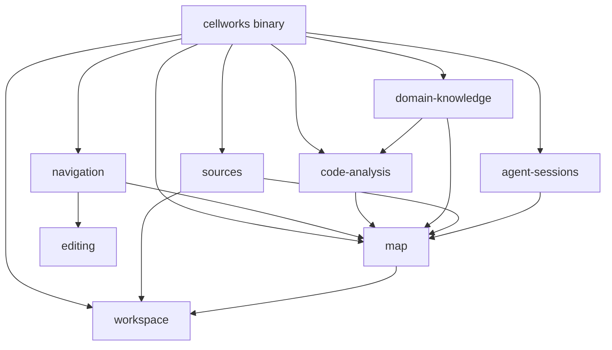

> Status: draft

# 5. Building Block View

## 5.1 Level 1: Cellworks and its neighbours

Cellworks is one native application. Its neighbours are described in [chapter 3](03-context.md): project folders,
git, Claude Code and its transcripts, Neovim, Atlassian's remote MCP, kubectl and Terraform files.

## 5.2 Level 2: crates

One crate per bounded context, plus the binary ([ADR-0002](../adr/0002-cargo-workspace-crate-per-bounded-context.md)).
Arrows point from a crate to the crate it depends on; they follow the [context map](../domain/context-map.md), where
the upstream context is the dependency.

Two relationships of the context map are not crate dependencies: CodeAnalysis → Workspace (worktrees become
projects) and AgentSessions → Workspace (session folders become projects, writes trigger rescans). As crate
dependencies they would form a cycle through `map → workspace`, so the binary wires them: it takes the events from
`code-analysis` and `agent-sessions` and calls `workspace`. Sources → Navigation ("show code") is a lane to a node in
another project and needs no crate dependency either. The binary also depends on `map` directly: it holds the opened
project's map and calls the Map's painter from the frame loop it owns.

| Crate | Context | Responsibility | Interface it offers |
|---|---|---|---|
| `workspace` | [Workspace](../domain/contexts/Workspace/Workspace.md) | Knows the projects: discovery, project identity (path or `jira:`/`otc:`/`data:` prefix, case-insensitive paths on macOS), settings, rescan requests. | Project registry, project identity, settings, rescan events. |
| `map` | [Map](../domain/contexts/Map/Map.md) | Owns the generic graph (districts, sub-districts, groups, nodes, items, lanes), the district strategy, the layout physics and the level-of-detail rendering of the map. | The graph as a published language for loaders; a loader trait; layout and paint of a graph; camera. |
| `navigation` | [Navigation](../domain/contexts/Navigation/Navigation.md) | Layers, selection, movement modes, Enter/Esc, folder views, item menu, palette, tree, history; routes keyboard focus. | Input handling over a graph; navigation commands. |
| `code-analysis` | [CodeAnalysis](../domain/contexts/CodeAnalysis/CodeAnalysis.md) | Scans code projects with tree-sitter ([ADR-0004](../adr/0004-tree-sitter-for-code-analysis.md)) and git ([ADR-0003](../adr/0003-external-tools-as-child-processes.md)) into a graph. | A loader for code projects; file and function facts for DomainKnowledge. |
| `domain-knowledge` | [DomainKnowledge](../domain/contexts/DomainKnowledge/DomainKnowledge.md) | Parses context cells and links them to code by glossary terms. | A loader contribution of cells and cell-reference lanes. |
| `sources` | [Sources](../domain/contexts/Sources/Sources.md) | Loaders for Jira (Atlassian MCP, OAuth), infrastructure (Terraform, kubectl) and data structures. | Loaders for `jira:`, `otc:` and `data:` projects. |
| `agent-sessions` | [AgentSessions](../domain/contexts/AgentSessions/AgentSessions.md) | Discovers sessions from transcripts, places them on the graph, and creates and steers sessions. | Session list and events; session drawing over the map. |
| `editing` | [Editing](../domain/contexts/Editing/Editing.md) | Embedded Neovim: grid, input, auto-save, pop-out windows. | Open a file at a line; editor focus. |
| `cellworks` (binary) | — | Wires the crates, registers loaders, owns the window and the frame loop. | Command-line entry points, including smoke modes. |

> TODO: depends on the decision about how Claude Code sessions are driven ([chapter 4](04-solution-strategy.md)).
> The `agent-sessions` crate's way of creating and steering sessions follows from it.

## 5.3 Level 3

Not yet needed. Added per crate when its inside becomes non-obvious.
