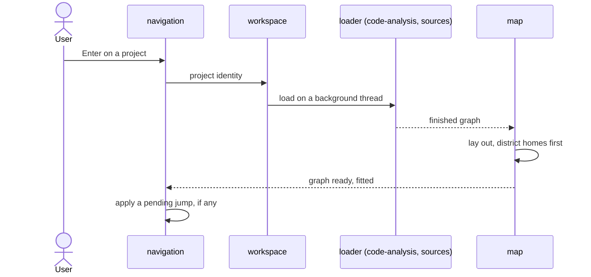
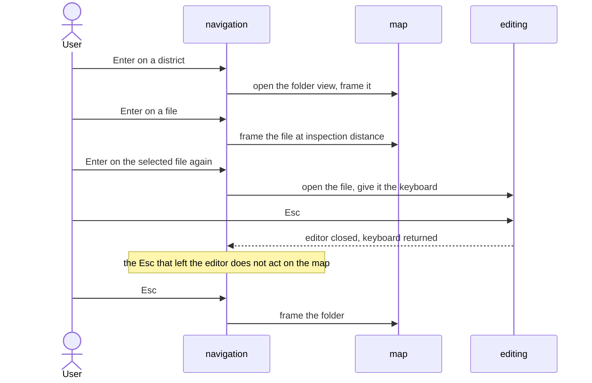
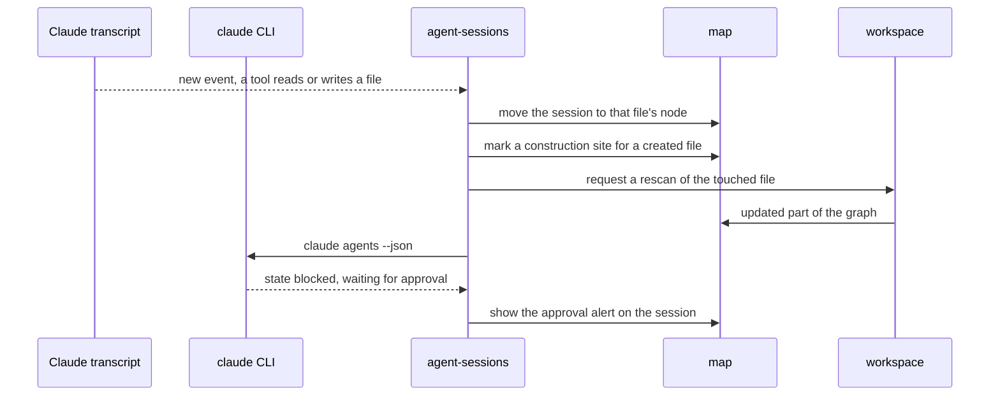

> Status: draft

# 6. Runtime View

The three scenarios that shape the system. Building blocks are those of [chapter 5](05-building-blocks.md).

## 6.1 Opening a project



- The UI thread never waits for a loader; until the graph arrives the project shows its loading state.
- The map's network (its lanes and what each building shows: doors, masts, skybridges, outlines) is worked out once
  per map on a background thread, like the map of a new lens; frames only draw it, and until it arrives the city
  stands without them.
- A jump into a project that is still loading is applied after the first fit.
- A failing loader marks only its own project as failed.

## 6.2 Moving through layers with the keyboard



- Keyboard input goes to whatever has focus (text field, editor, terminal, menu); the map acts only otherwise.
- Every view change is recorded in the history for Ctrl-O and Ctrl-I.

## 6.3 A session working in a project



- Every session on the machine is discovered from its transcript, whether Cellworks started it or not.
- Unknown transcript events are ignored.
- Waiting for approval is a state in `claude agents --json`, never a transcript event
  ([ADR-0010](../adr/0010-claude-code-background-sessions.md)).
- A session belongs to a project's city by the paths it touches, not by its working directory.

## 6.4 Starting and steering a session

```mermaid
sequenceDiagram
  participant E as Engineer
  participant Ag as agent-sessions
  participant C as claude CLI
  participant T as Claude transcript
  E->>Ag: give a session a task
  Ag->>C: claude --bg -n name "task" (clean environment)
  C-->>Ag: short id
  loop while the session runs
    Ag->>C: claude agents --json
    C-->>Ag: status and state (busy, idle; working, done, blocked)
    T-->>Ag: file reads and writes, pull request URL
  end
  E->>Ag: answer an approval or add to the task
  Ag->>C: claude attach id, in an embedded pseudo-terminal
  E->>Ag: detach
  Ag->>C: end the attach; the session keeps running
```

- Background sessions are hosted by Claude Code ([ADR-0010](../adr/0010-claude-code-background-sessions.md)) and survive restarts of Cellworks.
- A follow-up to a session that has stopped goes through `claude --resume <sessionId> --bg -n <name> "<prompt>"`.
