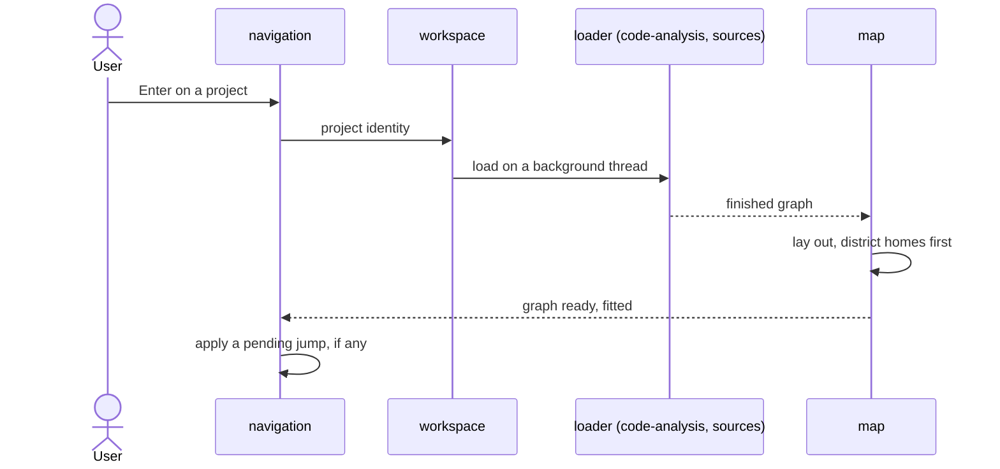
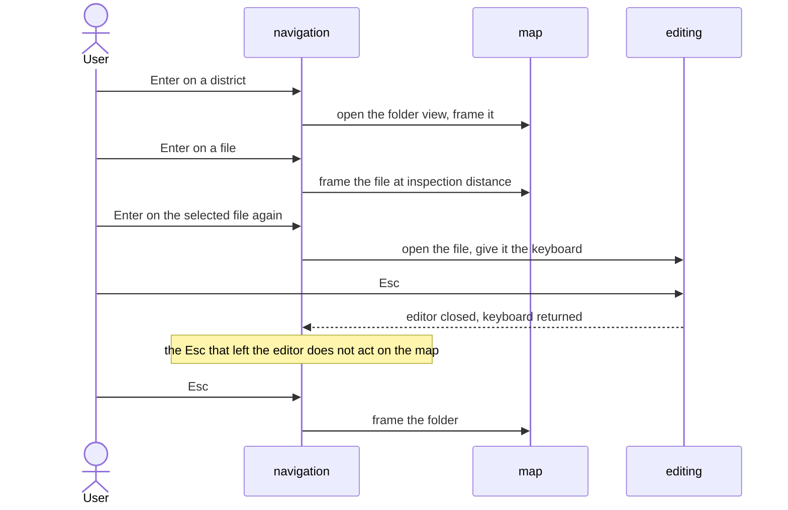
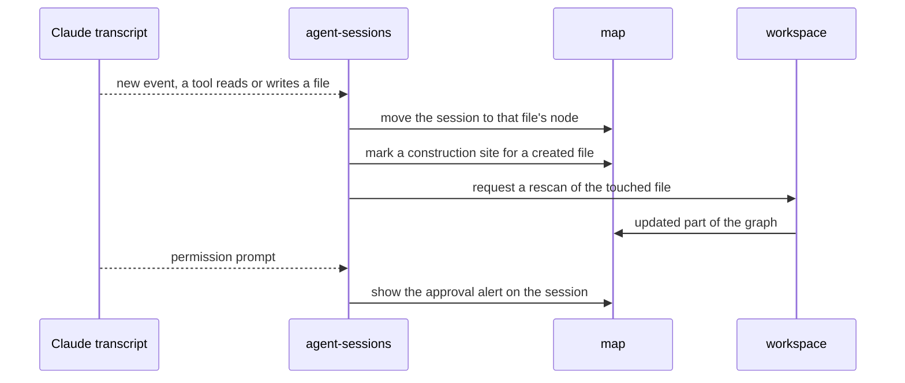

> Status: draft

# 6. Runtime View

The three scenarios that shape the system. Building blocks are those of [chapter 5](05-building-blocks.md).

## 6.1 Opening a project

- The UI thread never waits for a loader; until the graph arrives the project shows its loading state.
- A jump into a project that is still loading is applied after the first fit.
- A failing loader marks only its own project as failed.

## 6.2 Moving through layers with the keyboard

- Keyboard input goes to whatever has focus (text field, editor, terminal, menu); the map acts only otherwise.
- Every view change is recorded in the history for Ctrl-O and Ctrl-I.

## 6.3 A session working in a project

- Every session on the machine is discovered from its transcript, whether Cellworks started it or not.
- Unknown transcript events are ignored.
